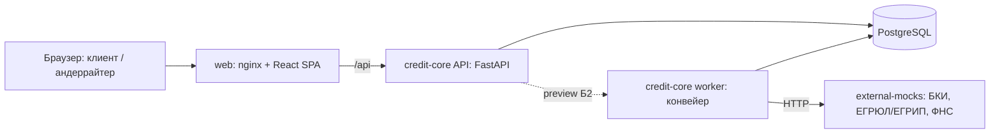

# Умный кредитный кабинет предпринимателя

Прототип для хакатона «Альфа-Будущее 2026». Черновик README для жюри (L-02a): места, которые ещё не проверены на стенде, помечены «[проверит тимлид]».

## Что это

Кабинет для индивидуальных предпринимателей (ИП) и обществ с ограниченной ответственностью (ООО), которые уже обслуживаются в банке. Предприниматель получает кредит онлайн и понимает, что происходит с заявкой, без банковской экспертизы. Данные о компании подставляются автоматически, лишнего вводить не нужно.

- **Клиент:** подбор продукта под цель, заявка, согласия с подписью кодом, лента статуса («что происходит» и «что от вас нужно»), решение с объяснением простыми словами, дозапрос в той же заявке, подписание договора (и поручительства для ООО), выдача и график платежей.
- **Банк:** заявка автоматически проходит конвейер (проверка → сбор сведений → оценка → решение). Исключения попадают в очередь андеррайтера. В его карточке видны факторы оценки и их первоисточники; андеррайтер принимает решение вручную с комментарием. Есть журнал событий и протокол для печати.

Оценка заявки построена на правилах: 12 признаков, балльная модель и кредитная политика. ML и LLM в прототипе нет. Все данные синтетические.

## Быстрый запуск

**Что нужно:**

- Git.
- Docker Desktop в режиме Linux containers, с Docker Compose v2.
- Свободный порт 8080.
- Оперативная память: [проверит тимлид: сколько нужно стенду].

**Шаги (Windows, PowerShell или cmd):**

```powershell
git clone https://github.com/dimagb/harkachi_alpha26.git
cd harkachi_alpha26
copy .env.example .env
docker compose up -d --build
docker compose ps
```

Повторяйте `docker compose ps`, пока все сервисы не станут `healthy`. Исключение — `migrate`: он применяет миграции и демо-данные, а потом завершается со статусом `exited (0)`, так и должно быть. Затем откройте [http://localhost:8080](http://localhost:8080).

Файл `.env` можно не создавать: без него стенд запускается со значениями по умолчанию (см. «Конфигурация»).

Если загрузка образов с Docker Hub обрывается, повторите команду. При постоянных обрывах скачайте базовые образы через зеркало и присвойте им исходные имена:

```powershell
docker pull mirror.gcr.io/library/node:24.22.1-alpine
docker tag mirror.gcr.io/library/node:24.22.1-alpine node:24.22.1-alpine
docker pull mirror.gcr.io/library/nginx:alpine
docker tag mirror.gcr.io/library/nginx:alpine nginx:alpine
docker pull mirror.gcr.io/library/postgres:16-alpine
docker tag mirror.gcr.io/library/postgres:16-alpine postgres:16-alpine
docker pull mirror.gcr.io/library/python:3.12.15-slim
docker tag mirror.gcr.io/library/python:3.12.15-slim python:3.12.15-slim
```

Если порт 8080 занят — `$env:WEB_PORT = "8081"`, затем снова `docker compose up -d --build`, и стенд будет на `http://localhost:8081`.

Остановить стенд: `docker compose down`. Удалить его вместе с данными для чистого прогона: `docker compose down -v`.

[проверит тимлид: холодный старт по этим шагам на чистом ПК и время запуска]

## Демо-учётки

Пароль у всех учёток — `demo2026`. На экране входа клик по учётке подставляет логин и пароль. Каждого персонажа лучше открывать в отдельном окне инкогнито, чтобы входы не путались.

| Логин | Кто это | Что показывает |
| --- | --- | --- |
| `ip_good` | ИП Смирнова Анна Викторовна | быстрое одобрение, подписание и выдача |
| `ooo_load` | ООО «Северный склад», директор | встречное предложение, две подписи: договор и поручительство |
| `ooo_load_accountant` | ООО «Северный склад», бухгалтер без права подписи | отправка заявки директору |
| `ooo_gap` | ООО «Ремонт-Сервис» | банк просит уточнить данные |
| `ip_bad` | ИП Козлов Дмитрий Сергеевич | отказ с понятной причиной |
| `ooo_border` | ООО «ТехноМонтаж» | пограничная оценка, решение специалиста банка |
| `ooo_aml` | ООО «Альфа-Трейд» | отказ по дополнительным проверкам: внутренние детали клиент не видит |
| `underwriter` | Орлова Мария Андреевна, специалист банка | очередь, карточка андеррайтера, журнал |

Исход каждой заявки задан профилем компании (синтетические ответы внешних источников привязаны к ИНН) и параметрами заявки. Ниже указаны параметры, при которых получаются ожидаемые числа.

## Сценарий проверки за 15 минут

Каждый шаг создаёт новую заявку: «Получить финансирование» → продукт и параметры → согласия → «Подписать и отправить» → «Получить код» → «Подставить» → подтвердить. Конвейер делает паузу 2 с между шагами, поэтому видно, как заявка движется по ленте. Решение приходит в течение 30 с.

На любом экране клиента не должно быть внутренних кодов (`GRADE_C`, `SF_OVERDUE`), баллов и класса оценки.

1. **`ip_good` — одобрение, подпись, выдача.** Экспресс-кредит, 1 500 000 ₽, 24 мес., оборотные средства, выручка 14 000 000 ₽, три согласия (включая согласие на авто-решение).
   Ожидаем: «Банк одобрил 1 500 000 ₽», ставка 22 %, платёж 77 817 ₽, объяснение решения. Затем «Принять» → «Подписать договор» → код. Ожидаем «Договор подписан, готовим выдачу», а через несколько секунд «Кредит выдан: 1 500 000 ₽» и график из 24 платежей по 77 817 ₽ с последним остатком 0. [проверит тимлид: подпись и выдача на стенде]
2. **`ooo_gap` — дозапрос.** Экспресс-кредит, 1 000 000 ₽, 24 мес., оборудование, выручка 48 000 000 ₽, два согласия.
   Ожидаем: «Нужно уточнить данные», пункт про подтверждение выручки. Ответ: выручка 48 000 000, комментарий «Часть выручки поступает на расчётный счёт в другом банке». После ответа — одобрение 1 000 000 ₽, 22 %, 51 878 ₽.
3. **`ooo_load_accountant` → `ooo_load` — подпись руководителя, встречное, две подписи.** Бухгалтер создаёт заявку: оборотный кредит, 4 000 000 ₽, 12 мес., оборотные средства, выручка 24 000 000 ₽. Согласий у него нет, есть подсказка «Отправить заявку может руководитель…». Бухгалтер нажимает «Отправить на подпись директору».
   Директор `ooo_load` открывает «Мои заявки» → заявку «ждёт подписи» → два согласия → подача. Ожидаем встречное предложение: 2 850 000 ₽ на 24 мес., 23 %, 149 264 ₽, и понятно, почему сумма меньше запрошенной. Директор принимает предложение и подписывает по очереди договор и поручительство (у обеих подписей «это вы»). Затем выдача 2 850 000 ₽. [проверит тимлид: две подписи и выдача на стенде]
4. **`ip_bad` — отказ с причиной и пересмотр.** Экспресс-кредит, 700 000 ₽, 12 мес., оборотные средства, выручка 9 500 000 ₽, три согласия.
   Ожидаем отказ: причина про кредитную историю простым языком и что сделать. Кнопка «Не согласен с решением» → объяснение → отправить. Заявка попадает в очередь андеррайтера с причиной «Клиент не согласен с решением». [проверит тимлид: пересмотр на стенде]
   Похожий случай — `ooo_aml` (экспресс-кредит, 1 000 000 ₽, 12 мес., выручка 36 000 000 ₽): отказ с категорией «Дополнительные проверки», и нигде нет слов AML, ПОД/ФТ, 115-ФЗ, «стоп-фактор».
5. **`ooo_border` + `underwriter` — ручное решение.** Клиент `ooo_border` подаёт экспресс-кредит, 1 000 000 ₽, 24 мес., оборотные средства, выручка 12 000 000 ₽. Ожидаем: «Заявку рассматривает специалист», оферты пока нет.
   Андеррайтер `underwriter` открывает «Очередь». В ней заявка с причиной «Пограничная оценка», оценкой C и временем ожидания. В карточке:
   - итог 54 / 100, класс C;
   - 12 факторов по группам; клик по фактору раскрывает первоисточник (ЕГРЮЛ / БКИ / ФНС / обороты) со временем получения по Москве;
   - график оборотов за 12 мес.;
   - рекомендация «Одобрить 1 000 000 ₽ на 24 мес. под 26 %», платёж 53 875 ₽.

   Андеррайтер нажимает «Одобрить», пишет комментарий и принимает решение. Клиент видит оферту 1 000 000 ₽, 26 %, 53 875 ₽, а комментарий специалиста и баллы ему не видны.
6. **`underwriter` — журнал, протокол, перемотка времени.** «Журнал банка» → фильтр по этапам → клик по строке: события по заявке, «Открыть карточку», «Печать протокола». В протоколе (Ctrl+P): таблица 12 факторов, расчёт, история. «Перемотать время» на 31 день у заявки с офертой → «Срок истёк — заявка закрыта», а клиент видит «Истекла» и «Подать новую заявку». [проверит тимлид: журнал и перемотка времени на стенде]

Полная версия проверки с исходами андеррайтера (встречное, отказ, дозапрос, ошибки формы) лежит в [docs/notes/stand-checklist.md](docs/notes/stand-checklist.md). Ожидаемые числа по каждому персонажу — в [contracts/personas.json](contracts/personas.json).

## Архитектура

Стенд состоит из пяти сервисов docker compose.

- **`web`** — nginx: отдаёт React-приложение и пересылает запросы `/api` в API.
- **`api`** — FastAPI (credit-core): REST API, вход и роли, машина состояний заявки, андеррайтинг, подписание (симуляция), выдача, журнал.
- **`worker`** — тот же образ, что у `api`. Выполняет шаги конвейера (проверка → сбор сведений → оценка → выдача) с повторами и следит за истечением сроков.
- **`db`** — PostgreSQL; при запуске сервис `migrate` применяет миграции и загружает демо-данные (компании, пользователи, обороты, продукты, конфигурация решения).
- **`mocks`** — имитация внешних источников (БКИ, ЕГРЮЛ/ЕГРИП, ФНС) с синтетическими ответами по ИНН.

Наружу открыт только `web`.



Подробнее:

- [docs/architecture.md](docs/architecture.md) — стек, роли, enterprise-практики;
- [docs/state-machine.md](docs/state-machine.md) — состояния заявки и допустимые переходы (любой другой переход отклоняется с ошибкой `409 INVALID_TRANSITION`);
- [docs/assumptions.md](docs/assumptions.md) — допущения и моки.

## Конфигурация

Все переменные необязательны. По умолчанию стенд работает локально на синтетических данных. Переменные задаются в `.env`; образец — `.env.example`.

| Переменная | По умолчанию | Зачем |
| --- | --- | --- |
| `WEB_PORT` | `8080` | порт веб-интерфейса на компьютере |
| `POSTGRES_USER` | `credit` | пользователь PostgreSQL |
| `POSTGRES_PASSWORD` | `credit` | пароль PostgreSQL |
| `POSTGRES_DB` | `credit` | имя базы данных |
| `DATABASE_URL` | `postgresql+psycopg://credit:credit@db:5432/credit` | подключение `api` и `worker` к БД; при смене учётных данных PostgreSQL поменяйте и его |
| `JWT_SECRET` | `local-demo-secret-change-before-deployment` | ключ подписи токенов входа; перед развёртыванием не локально замените |
| `JWT_TTL_HOURS` | `8` | срок жизни токена входа, часы |
| `DEMO_MODE` | `true` | демо-режим стенда [проверит тимлид: что именно включает] |
| `DEMO_PASSWORD` | `demo2026` | пароль демо-учёток |
| `MOCKS_URL` | `http://mocks:8001/mock/v1` | адрес сервиса внешних источников |
| `LOG_LEVEL` | `INFO` | уровень подробности логов |

[проверит тимлид: таблица собрана по `docker-compose.yml`, файл `.env.example` прочитать не удалось — сверить список и значения]

## Проверка API

- **Swagger:** [http://localhost:8080/api/v1/docs](http://localhost:8080/api/v1/docs).
- **Доступность:** [http://localhost:8080/api/v1/health](http://localhost:8080/api/v1/health).
- **Готовность БД:** [http://localhost:8080/api/v1/ready](http://localhost:8080/api/v1/ready).

Коллекция [Bruno](https://www.usebruno.com/) проходит основные сценарии без интерфейса: вход восьми учёток, полный путь `ip_good` до выдачи, дозапрос `ooo_gap`, ручное одобрение `ooo_border` и типовые ошибки (401, 403, 409, 422). Нужны Node.js 22 или новее и запущенный стенд. Из корня репозитория:

```powershell
cd docs/api-collection
npx --yes @usebruno/cli@4.3.0 run --env local
```

Успех — все запросы и тесты зелёные, код выхода `0`. Каждый запуск создаёт три новые заявки, чистить стенд не нужно. Подробнее — [docs/api-collection/README.md](docs/api-collection/README.md).

## Допущения и моки

Главное (полный список — [docs/assumptions.md](docs/assumptions.md)):

- **Вход.** Клиент — действующий клиент банка и входит по тестовому логину (JWT). В проде вход шёл бы через SSO интернет-банка.
- **Внешние источники.** БКИ, ЕГРЮЛ/ЕГРИП и ФНС (налоговый долг, ФССП, банкротство) — мок-сервис с контрактами, близкими к реальным. Обороты по счёту и флаги ПОД/ФТ — синтетика во внутренней БД.
- **Согласия и подписи.** Это простая подпись кодом в интерфейсе: код показывается на экране, хэш документа пишется в журнал.
- **Выдача.** Создаются запись о выдаче и график платежей, без проводок в АБС. Отчёт в БКИ — событие в журнале.
- **Оценка.** Балльная модель на правилах: пороги и веса задала команда и откалибровала на синтетике. Ставка = ключевая ставка (параметр с датой) + спред − скидка.
- **Продукты.** Только кредиты без залога. Поручитель ООО — учредитель; в демо директор и есть единственный учредитель, поэтому подписывает поручительство в той же сессии.
- **Причины решения.** Клиенту показываются категория причины и что делать. Причины по ПОД/ФТ, СБ и антифроду скрыты за нейтральной формулировкой.
- **Сроки и паузы.** Сроки (дозапрос, оферта 30 дней) задаются в конфигурации, а в демо их воспроизводит команда «сдвинуть время». Между шагами конвейера стоит пауза 2 с, чтобы было видно движение заявки.

## Для разработчиков

### Быстрый старт для разработчика

Нужны Git и запущенный Docker Desktop с Linux containers и Docker Compose v2. Из корня репозитория в PowerShell:

```powershell
docker compose up -d --build --wait
```

Файл `.env` не требуется. Откройте [http://localhost:8080](http://localhost:8080): появится «API: ok». Swagger: [http://localhost:8080/api/v1/docs](http://localhost:8080/api/v1/docs). Готовность БД: [http://localhost:8080/api/v1/ready](http://localhost:8080/api/v1/ready).

На хост опубликован только web. Если порт занят:

```powershell
$env:WEB_PORT = "8081"
docker compose up -d --build --wait
```

Настройки перечислены в `.env.example`; при необходимости скопируйте его в `.env`. При изменении учётных данных PostgreSQL обновите также `DATABASE_URL`. Значения по умолчанию предназначены для локального демо на синтетических данных. Пользователей и бизнес-таблиц каркас пока не создаёт.

```powershell
docker compose ps -a
docker compose logs -f api worker
docker compose up -d
docker compose down
```

Повторный запуск сохраняет данные и повторяет идемпотентные миграции. `docker compose down -v` удаляет локальную БД — используйте только для чистого прогона.

Для локальной разработки установите uv и Node 24.22.1. Python 3.12 uv загрузит сам. Проверки:

```powershell
cd backend
uv sync --frozen
uv run ruff check .
uv run ruff format --check .
uv run pytest
uv run python -m scripts.export_openapi
cd ../mocks
uv sync --frozen
uv run ruff check .
uv run ruff format --check .
uv run pytest
cd ../frontend
npm ci
npm run gen:api
npm run lint
npm run typecheck
npm test
npm run build
cd ..
python -X utf8 contracts/decision_reference.py --write
```

API локально: из `backend/` — `uv run uvicorn app.main:app --reload --port 8000`; frontend: из `frontend/` — `npm run dev`. Vite проксирует `/api` на localhost:8000. Для `/ready` нужна доступная локальному процессу PostgreSQL и соответствующий `DATABASE_URL`; контейнерная БД на хост не публикуется. Моки: из `mocks/` — `uv run uvicorn app.main:app --port 8001`.

После изменения API выполните экспорт OpenAPI, затем `npm run gen:api`. Снимки фиксируются в Git и проверяются CI; вручную их не редактируют.
