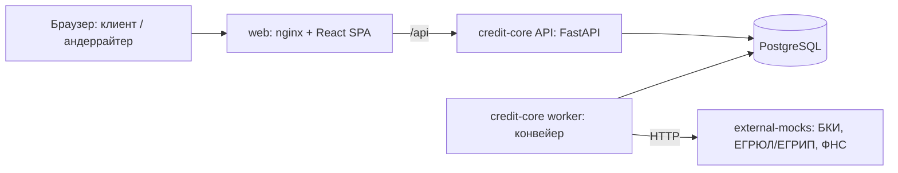

# Умный кредитный кабинет предпринимателя

Прототип для хакатона «Альфа-Будущее 2026», кейс «Умный кредитный кабинет предпринимателя». Стенд запускается тремя командами на Windows с Docker Desktop. Внешних и платных сервисов нет: внешние источники (БКИ, ЕГРЮЛ/ЕГРИП, ФНС) имитирует локальный сервис, все данные синтетические.

**Что посмотреть первым:**

1. [docs/product.md](docs/product.md) — что мы сделали и почему: возможности, исследования → решения, преимущества, скриншоты.
2. Запуск — три команды в разделе «Быстрый запуск» ниже.
3. «Сценарий проверки»: сценарий 1 (`ip_good` — от заявки до выдачи) и сценарий 5 (`ooo_border` + андеррайтер — ручное решение).

## Что это

Кабинет для индивидуальных предпринимателей (ИП) и обществ с ограниченной ответственностью (ООО), которые уже обслуживаются в банке. Предприниматель получает кредит онлайн и понимает, что происходит с заявкой, без банковской экспертизы. Данные о компании подставляются автоматически, лишнего вводить не нужно.

- **Клиент:** подбор продукта под цель, заявка, согласия с подписью кодом, лента статуса («что происходит» и «что от вас нужно»), решение с объяснением простыми словами, дозапрос в той же заявке, подписание договора (и поручительства для ООО), выдача и график платежей.
- **Банк:** заявка автоматически проходит конвейер (проверка → сбор сведений → оценка → решение). Исключения попадают в очередь андеррайтера. В его карточке видны факторы оценки и их первоисточники; андеррайтер принимает решение вручную с комментарием. Есть журнал событий и протокол для печати.

Оценка заявки построена на правилах: 12 признаков, балльная модель и кредитная политика. ML и LLM в прототипе нет. Все данные синтетические.

## Быстрый запуск

**Что нужно:**

- Git.
- Docker Desktop в режиме Linux containers, с Docker Compose v2. На Windows Docker Desktop требует WSL 2: установщик включает его сам и просит перезагрузить компьютер (установка Git, WSL 2 и Docker Desktop на репетиции — около 4 минут плюс перезагрузка).
- Свободный порт 8080.
- Оперативная память: выделите Docker Desktop не меньше 4 ГБ; сам стенд после всех сценариев занимает около 270 МБ (замер на репетиции), образы — около 2 ГБ на диске.
- Node.js, Python и другие инструменты не нужны — всё собирается внутри Docker.

**Шаги (Windows, PowerShell или cmd):**

```powershell
git clone https://github.com/dimagb/harkachi_alpha26.git
cd harkachi_alpha26
docker compose up -d --build --wait
```

Команда завершается сама, когда все сервисы готовы (`healthy`). Затем откройте [http://localhost:8080](http://localhost:8080) — откроется экран входа.

Проверить состояние: `docker compose ps -a`. Сервис `migrate` применяет миграции и демо-данные и завершается со статусом `exited (0)` — так и должно быть.

Создавать `.env` не обязательно: значения по умолчанию заданы в `docker-compose.yml`, образец настроек — `.env.example` (см. «Конфигурация»).

Если что-то пошло не так (обрывы загрузки образов, занятый порт) — раздел «Если запуск не удался» ниже.

Остановить стенд: `docker compose down`. Удалить его вместе с данными для чистого прогона: `docker compose down -v`.

Первый запуск без скачанных образов — около 1 мин 41 с: скачиваются базовые образы и собираются сервисы (замер на репетиции: Ryzen AI 9, 32 ГБ, Windows 11, обычный домашний интернет; на медленном интернете дольше). Повторный запуск с нуля, когда образы уже скачаны, — 37–43 с. После запуска стенд работает без интернета.

## Демо-учётки

Пароль у всех учёток — `demo2026`. На экране входа клик по учётке подставляет логин и пароль. Каждого персонажа лучше открывать в отдельном окне инкогнито, чтобы входы не путались.

| Логин | Кто это | Что показывает |
| --- | --- | --- |
| `ip_good` | ИП Смирнова Анна Викторовна | быстрое одобрение, подписание и выдача |
| `ooo_load` | ООО «Северный склад», директор | встречное предложение, две подписи: договор и поручительство |
| `ooo_load_accountant` | ООО «Северный склад», бухгалтер без права подписи | отправка заявки директору |
| `ooo_gap` | ООО «Ремонт-Сервис» | банк просит уточнить данные |
| `ip_bad` | ИП Козлов Дмитрий Сергеевич | отказ с понятной причиной |
| `ooo_border` | ООО «ТехноМонтаж» | пограничная оценка, решение специалиста банка |
| `ooo_aml` | ООО «Альфа-Трейд» | отказ по дополнительным проверкам: внутренние детали клиент не видит |
| `underwriter` | Орлова Мария Андреевна, специалист банка | очередь, карточка андеррайтера, журнал |

Исход каждой заявки задан профилем компании (синтетические ответы внешних источников привязаны к ИНН) и параметрами заявки. Ниже указаны параметры, при которых получаются ожидаемые числа.

## Сценарий проверки за 15 минут

В каждом сценарии подаётся новая заявка: «Получить финансирование» → цель («Зачем нужны деньги») → продукт → сумма, срок и выручка → согласия → «Подписать и отправить» → «Получить код» → «Подставить» → подтвердить. Конвейер делает паузу 2 с между шагами, поэтому видно, как заявка движется по ленте. Решение приходит в течение 30 с.

Обратите внимание: на экранах клиента нет внутренних кодов, баллов и класса оценки — только понятные формулировки и что сделать дальше.

1. **`ip_good` — одобрение, подпись, выдача.** Цель «Оборотные средства» → Экспресс-кредит, 1 500 000 ₽, 24 мес., выручка 14 000 000 ₽, три согласия (включая согласие на авто-решение).
   Ожидаем: «Банк одобрил 1 500 000 ₽», ставка 22 %, платёж 77 817 ₽, объяснение решения. Затем «Принять» → «Подписать договор» → код. Ожидаем «Договор подписан, готовим выдачу», а через несколько секунд «Кредит выдан: 1 500 000 ₽» и график из 24 платежей по 77 817 ₽ с последним остатком 0.
2. **`ooo_gap` — дозапрос.** Цель «Оборудование» → Экспресс-кредит, 1 000 000 ₽, 24 мес., выручка 48 000 000 ₽, два согласия.
   Ожидаем: «Нужно уточнить данные», пункт про подтверждение выручки. Банк видит, что заявленная выручка сильно больше поступлений на счёт, и просит подтвердить её. Ответ: подтвердить выручку 48 000 000 и пояснить расхождение — комментарий «Часть выручки поступает на расчётный счёт в другом банке». После ответа — одобрение 1 000 000 ₽, 22 %, 51 878 ₽.
3. **`ooo_load_accountant` → `ooo_load` — подпись руководителя, встречное, две подписи.** Бухгалтер создаёт заявку: цель «Оборотные средства» → Оборотный кредит, 4 000 000 ₽, 12 мес., выручка 24 000 000 ₽. Согласий у него нет, есть подсказка «Отправить заявку может руководитель…». Бухгалтер нажимает «Отправить на подпись директору».
   Директор `ooo_load` открывает «Мои заявки» → заявку «ждёт подписи» → два согласия → подача. Ожидаем встречное предложение: 2 850 000 ₽ на 24 мес., 23 %, 149 264 ₽, и понятно, почему сумма меньше запрошенной, а срок длиннее (было 4 000 000 ₽ на 12 мес.). Директор принимает предложение и подписывает по очереди договор и поручительство (у обеих подписей «это вы»). Затем выдача 2 850 000 ₽.
4. **`ip_bad` — отказ с причиной и пересмотр.** Цель «Оборотные средства» → Экспресс-кредит, 700 000 ₽, 12 мес., выручка 9 500 000 ₽, три согласия.
   Ожидаем отказ: причина про кредитную историю простым языком и что сделать. В блоке «Не согласны с решением?» нажать «Попросить пересмотр», заполнить поле «Почему вы не согласны» и отправить. Заявка попадает в очередь андеррайтера с причиной «Клиент не согласен с решением».

   **Отдельный сценарий, другая учётка — `ooo_aml`.** Цель «Оборотные средства» → Экспресс-кредит, 1 000 000 ₽, 12 мес., выручка 36 000 000 ₽. Ожидаем: отказ с категорией «Дополнительные проверки», и нигде нет слов AML, ПОД/ФТ, 115-ФЗ, «стоп-фактор».
5. **`ooo_border` + `underwriter` — ручное решение.** Клиент `ooo_border`: цель «Оборотные средства» → Экспресс-кредит, 1 000 000 ₽, 24 мес., выручка 12 000 000 ₽. Ожидаем: «Заявку рассматривает специалист», оферты пока нет.

   **Дальше — под учёткой андеррайтера.** Выйдите и войдите как `underwriter`, откройте «Очередь».

   В очереди и журнале банка есть фоновые заявки других компаний (около 60, загружаются один раз при первом запуске). Очередь отсортирована по времени ожидания, поэтому новая заявка `ooo_border` (ООО «ТехноМонтаж») — **внизу очереди**.

   В очереди — заявка `ooo_border` с причиной «Пограничная оценка», оценкой C и временем ожидания. В карточке:
   - итог 54 / 100, класс C;
   - 12 факторов по группам; клик по фактору раскрывает первоисточник (ЕГРЮЛ / БКИ / ФНС / обороты) со временем получения по Москве;
   - график оборотов за 12 мес.;
   - рекомендация «Одобрить 1 000 000 ₽ на 24 мес. под 26 %», платёж 53 875 ₽.

   Андеррайтер нажимает «Одобрить», пишет комментарий и принимает решение. Клиент видит оферту 1 000 000 ₽, 26 %, 53 875 ₽, а комментарий специалиста и баллы ему не видны.
6. **`underwriter` — журнал, протокол, перемотка времени.** «Журнал банка» → фильтр по этапам → клик по строке: события по заявке, «Открыть карточку», «Печать протокола». В протоколе (Ctrl+P): таблица 12 факторов, расчёт, история. «Перемотать время» на 31 день у заявки с офертой → «Срок истёк — заявка закрыта», а клиент видит статус «Срок истёк» и «Подать новую заявку». У заявки с дозапросом то же — перемотка на 6 дней.

Полная версия проверки с исходами андеррайтера (встречное, отказ, дозапрос, ошибки формы) лежит в [docs/notes/stand-checklist.md](docs/notes/stand-checklist.md). Ожидаемые числа по каждому персонажу — в [contracts/personas.json](contracts/personas.json).

## Как мы проверяли

| Проверка | Результат | Отчёт |
| --- | --- | --- |
| Модульные и интеграционные тесты | бэкенд 1 470 тестов, фронтенд 364 (26.10, все зелёные); покрытие строк 97 % и 97,3 % (замер 24.10) | [docs/audit/numbers.md](docs/audit/numbers.md) |
| Сквозные тесты через API на стенде | 268 тестов: все персонажи получают ожидаемые исходы и числа, доступ к чужому, гонки, переходы автомата | [tests/e2e/api](tests/e2e/api/README.md) |
| Автомат состояний: каждый из 31 перехода заявки выполняется | **31 из 31**: 25 — сквозными тестами API на стенде (`tests/e2e/api/test_transitions.py` и персонажи), 6 кратковременных и сбойных — модульными тестами бэкенда; лишних переходов и тупиков нет | [docs/audit/state-coverage.md](docs/audit/state-coverage.md) |
| Демо-путь в интерфейсе на стенде (Playwright, обе роли): подача → выдача, дозапрос, бухгалтер → директор → две подписи, ручное решение, отказ и пересмотр, доппроверки, истечение сроков, отзыв; 1440 и 375 px | 8 из 8 сценариев зелёные, на каждом шаге — без ошибок консоли и неожиданных ответов API | [docs/audit/demo-path.md](docs/audit/demo-path.md); запуск — `cd frontend; npm run e2e:ui` |
| Автообход интерфейса на стенде: 8 учёток, 1440 / 1366 / 375 px, консоль, ошибки API, коды в тексте, доступность (axe-core) | критичных находок 0 | [docs/audit/ui.md](docs/audit/ui.md) |
| Безопасность: доступ к чужим заявкам, гонки, утечки внутренних полей клиенту, секреты, логи без ПДн, Schemathesis, аудит зависимостей | уязвимостей зависимостей 0; находки исправлены или приняты с обоснованием | [docs/audit/security.md](docs/audit/security.md) |
| Скорость и целевые показатели (SLA) | подача → автоматическое решение ≈ 10 с при цели ≤ 60 с; p95 ответов API 9–92 мс при цели ≤ 300 мс; запуск стенда без скачанных образов 1 мин 41 с при цели ≤ 5 мин, повторный 37–43 с (ноутбук, 1 пользователь) | [docs/audit/numbers.md](docs/audit/numbers.md), раздел «Целевые показатели» |
| Лицензии зависимостей | все с открытыми лицензиями; LGPL (`psycopg`) и MPL (`certifi`) используются без изменений | [THIRD_PARTY_NOTICES.md](THIRD_PARTY_NOTICES.md), [docs/audit/licenses.md](docs/audit/licenses.md) |
| Репетиция «как у жюри» на ноутбуке, очищенном по инструкции (без образов и клона), — только по README, команды вручную | от `git clone` до конца всех сценариев 15 мин 38 с; холодный запуск 1 мин 41 с; стенд ≈ 271 МиБ ОЗУ; работает без сети | [docs/demo/rehearsal-T20.md](docs/demo/rehearsal-T20.md) |
| Ручные проходы по чек-листу | два прохода, находки исправлены | [docs/notes/stand-pass-1.md](docs/notes/stand-pass-1.md) |

## Архитектура

Стенд состоит из пяти сервисов docker compose.

- **`web`** — nginx: отдаёт React-приложение и пересылает запросы `/api` в API.
- **`api`** — FastAPI (credit-core): REST API, вход и роли, машина состояний заявки, андеррайтинг, подписание (симуляция), выдача, журнал.
- **`worker`** — тот же образ, что у `api`. Выполняет шаги конвейера (проверка → сбор сведений → оценка → выдача) с повторами и следит за истечением сроков.
- **`db`** — PostgreSQL; при запуске сервис `migrate` применяет миграции и загружает демо-данные (компании, пользователи, обороты, продукты, конфигурация решения).
- **`mocks`** — имитация внешних источников (БКИ, ЕГРЮЛ/ЕГРИП, ФНС) с синтетическими ответами по ИНН.

Наружу открыт только `web`.



Подробнее:

- [docs/architecture.md](docs/architecture.md) — стек, роли, enterprise-практики;
- [docs/state-machine.md](docs/state-machine.md) — состояния заявки и допустимые переходы (любой другой переход отклоняется с ошибкой `409 INVALID_TRANSITION`);
- [docs/assumptions.md](docs/assumptions.md) — допущения и моки.

## Документация

| Что требует кейс | Где |
| --- | --- |
| Продуктовое описание: возможности, исследования → решения, преимущества, скриншоты | [docs/product.md](docs/product.md) |
| Архитектурная схема | раздел «Архитектура» выше, [docs/architecture.md](docs/architecture.md) |
| Модель кредитного процесса | [docs/process.md](docs/process.md) |
| Диаграмма состояний заявки | [docs/state-machine.md](docs/state-machine.md) |
| Модель принятия решения: признаки, баллы, кредитная политика | [docs/decision-model.md](docs/decision-model.md), эталон расчёта — [contracts/decision_reference.py](contracts/decision_reference.py) |
| Модель данных | [docs/data-model.md](docs/data-model.md) |
| Описание API | [contracts/api.md](contracts/api.md), коды и тексты — [contracts/codes.md](contracts/codes.md) |
| OpenAPI / Swagger | [contracts/openapi.json](contracts/openapi.json); на стенде — [http://localhost:8080/api/v1/docs](http://localhost:8080/api/v1/docs) |
| Коллекция запросов | [docs/api-collection](docs/api-collection/README.md) (Bruno) |
| Контракты внешних источников (моки) | [contracts/external-mocks.md](contracts/external-mocks.md) |
| Тестовые сценарии | [docs/test-scenarios.md](docs/test-scenarios.md), ручной чек-лист — [docs/notes/stand-checklist.md](docs/notes/stand-checklist.md) |
| Синтетические данные и учётки | раздел «Демо-учётки», [contracts/personas.json](contracts/personas.json), [data/README.md](data/README.md) |
| Допущения и моки | [docs/assumptions.md](docs/assumptions.md) |
| Сторонние компоненты | [THIRD_PARTY_NOTICES.md](THIRD_PARTY_NOTICES.md) |
| Требования кейса и как они закрыты | [docs/requirements-checklist.md](docs/requirements-checklist.md) |

## Конфигурация

Все переменные необязательны. По умолчанию стенд работает локально на синтетических данных. Переменные задаются в `.env`; образец — `.env.example`.

| Переменная | По умолчанию | Зачем |
| --- | --- | --- |
| `WEB_PORT` | `8080` | порт веб-интерфейса на компьютере; открыт на всех сетевых интерфейсах (стенд виден из локальной сети) — так нужно для демо на сервере; на общем ноутбуке можно ограничить: `WEB_PORT=127.0.0.1:8080` |
| `POSTGRES_USER` | `credit` | пользователь PostgreSQL |
| `POSTGRES_PASSWORD` | `credit` | пароль PostgreSQL |
| `POSTGRES_DB` | `credit` | имя базы данных |
| `DATABASE_URL` | `postgresql+psycopg://credit:credit@db:5432/credit` | подключение `api` и `worker` к БД; при смене учётных данных PostgreSQL поменяйте и его |
| `JWT_SECRET` | `local-demo-secret-change-before-deployment` | ключ подписи токенов входа; при `DEMO_MODE=false` обязателен свой секрет (не короче 32 символов), иначе API и worker не стартуют |
| `JWT_TTL_HOURS` | `8` | срок жизни токена входа, часы |
| `DEMO_MODE` | `true` | показывает код подтверждения на экране (кнопка «Подставить») и включает перемотку времени в журнале банка. При `false` код не показывается, а перемотка отвечает 404, поэтому для демо не выключать |
| `DEMO_PASSWORD` | `demo2026` | пароль демо-учёток |
| `MOCKS_URL` | `http://mocks:8001/mock/v1` | адрес сервиса внешних источников |
| `LOG_LEVEL` | `INFO` | уровень подробности логов |

Значения по умолчанию заданы в `docker-compose.yml`.

## Проверка API

- **Swagger:** [http://localhost:8080/api/v1/docs](http://localhost:8080/api/v1/docs).
- **Доступность:** [http://localhost:8080/api/v1/health](http://localhost:8080/api/v1/health).
- **Готовность БД:** [http://localhost:8080/api/v1/ready](http://localhost:8080/api/v1/ready).

Коллекция [Bruno](https://www.usebruno.com/) проходит основные сценарии без интерфейса: вход восьми учёток, полный путь `ip_good` до выдачи, дозапрос `ooo_gap`, ручное одобрение `ooo_border` и типовые ошибки (401, 403, 409, 422). Нужны Node.js 22 или новее и запущенный стенд. Из корня репозитория:

```powershell
cd docs/api-collection
npx --yes @usebruno/cli@4.3.0 run --env local
```

Успех — все запросы и тесты зелёные, код выхода `0`. Общее число запросов в отчёте меняется от запуска к запуску: запросы-ожидания повторяются, пока заявка не дойдёт до нужного состояния. Каждый запуск создаёт три новые заявки, чистить стенд не нужно. Подробнее — [docs/api-collection/README.md](docs/api-collection/README.md).

## Допущения и моки

Главное (полный список — [docs/assumptions.md](docs/assumptions.md)):

- **Вход.** Клиент — действующий клиент банка и входит по тестовому логину (JWT). В проде вход шёл бы через SSO интернет-банка.
- **Внешние источники.** БКИ, ЕГРЮЛ/ЕГРИП и ФНС (налоговая задолженность), ФССП (исполнительные производства) и сведения о банкротстве — мок-сервис с контрактами, близкими к реальным. Обороты по счёту и флаги ПОД/ФТ — синтетика во внутренней БД.
- **Согласия и подписи.** Это простая подпись кодом в интерфейсе: код показывается на экране, хэш документа пишется в журнал.
- **Выдача.** Создаются запись о выдаче и график платежей, без проводок в АБС. Отчёт в БКИ — событие в журнале.
- **Оценка.** Балльная модель на правилах: пороги и веса задала команда и откалибровала на синтетике. Ставка = ключевая ставка (параметр с датой) + спред − скидка.
- **Продукты.** Только кредиты без залога. Поручитель ООО — учредитель; в демо директор и есть единственный учредитель, поэтому подписывает поручительство в той же сессии.
- **Причины решения.** Клиенту показываются категория причины и что делать. Причины по ПОД/ФТ, СБ и антифроду скрыты за нейтральной формулировкой.
- **Сроки и паузы.** Сроки (дозапрос, оферта 30 дней) задаются в конфигурации, а в демо их воспроизводит кнопка «Перемотать время» в «Журнале банка». Между шагами конвейера стоит пауза 2 с, чтобы было видно движение заявки.

## Если запуск не удался

Если поле ввода в интерфейсе не реагирует на клики — обновите страницу (F5) или откройте её в другом браузере.

Если загрузка образов с Docker Hub обрывается, повторите команду. При постоянных обрывах скачайте базовые образы через зеркало и присвойте им исходные имена:

```powershell
docker pull mirror.gcr.io/library/node:24.22.1-alpine
docker tag mirror.gcr.io/library/node:24.22.1-alpine node:24.22.1-alpine
docker pull mirror.gcr.io/library/nginx:alpine
docker tag mirror.gcr.io/library/nginx:alpine nginx:alpine
docker pull mirror.gcr.io/library/postgres:16-alpine
docker tag mirror.gcr.io/library/postgres:16-alpine postgres:16-alpine
docker pull mirror.gcr.io/library/python:3.12.15-slim
docker tag mirror.gcr.io/library/python:3.12.15-slim python:3.12.15-slim
```

Если порт 8080 занят (или по адресу открывается не экран входа «Кредитный кабинет») — `$env:WEB_PORT = "8081"`, затем снова `docker compose up -d --build --wait`, и стенд будет на `http://localhost:8081`. В cmd вместо `$env:WEB_PORT = "8081"` — `set WEB_PORT=8081`.

## Для разработчиков

### Быстрый старт для разработчика

Нужны Git и запущенный Docker Desktop с Linux containers и Docker Compose v2. Из корня репозитория в PowerShell:

```powershell
docker compose up -d --build --wait
```

Файл `.env` не требуется. Откройте [http://localhost:8080](http://localhost:8080): откроется экран входа. Swagger: [http://localhost:8080/api/v1/docs](http://localhost:8080/api/v1/docs). Готовность БД: [http://localhost:8080/api/v1/ready](http://localhost:8080/api/v1/ready).

На хост опубликован только web. Если порт занят:

```powershell
$env:WEB_PORT = "8081"
docker compose up -d --build --wait
```

Настройки перечислены в `.env.example`; при необходимости скопируйте его в `.env`. При изменении учётных данных PostgreSQL обновите также `DATABASE_URL`. Значения по умолчанию предназначены для локального демо на синтетических данных. При первом запуске сервис `migrate` создаёт таблицы и загружает демо-данные.

```powershell
docker compose ps -a
docker compose logs -f api worker
docker compose up -d
docker compose down
```

Повторный запуск сохраняет данные и повторяет идемпотентные миграции. `docker compose down -v` удаляет локальную БД — используйте только для чистого прогона.

Для локальной разработки установите uv и Node 24.22.1 (как в CI). Python 3.12 uv загрузит сам. Проверки:

```powershell
cd backend
uv sync --frozen
uv run ruff check .
uv run ruff format --check .
uv run pytest
uv run python -m scripts.export_openapi
cd ../mocks
uv sync --frozen
uv run ruff check .
uv run ruff format --check .
uv run pytest
cd ../frontend
npm ci
npm run gen:api
npm run lint
npm run typecheck
npm test
npm run build
cd ..
python -X utf8 contracts/decision_reference.py --write
```

API локально: из `backend/` — `uv run uvicorn app.main:app --reload --port 8000`; frontend: из `frontend/` — `npm run dev`. Vite проксирует `/api` на localhost:8000. Для `/ready` нужна доступная локальному процессу PostgreSQL и соответствующий `DATABASE_URL`; контейнерная БД на хост не публикуется. Моки: из `mocks/` — `uv run uvicorn app.main:app --port 8001`.

После изменения API выполните экспорт OpenAPI, затем `npm run gen:api`. Снимки фиксируются в Git и проверяются CI; вручную их не редактируют.
