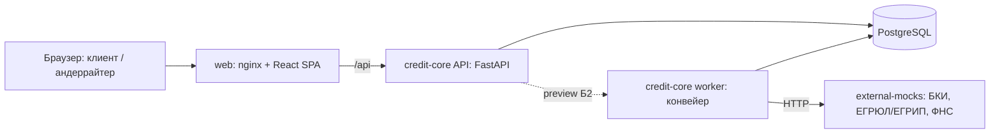

# Архитектура и стек

## 1. Развилка: стек бэкенда

| | 1. Python + FastAPI (рекомендую) | 2. Java/Kotlin + Spring Boot | 3. TypeScript + NestJS |
| --- | --- | --- | --- |
| Скорость разработки агентами за 2,5 дня | высокая | низкая (много шаблонного кода, долгая сборка) | средняя |
| OpenAPI (T8) | генерируется из кода автоматически → документ всегда совпадает с реализацией | springdoc, нужна дисциплина аннотаций | декораторы, частично вручную |
| Валидация данных (F8) | Pydantic v2 из коробки | Bean Validation | class-validator |
| Правила скоринга | естественно на Python, легко тестировать | многословно | нормально |
| «Похоже на банк» (критерий 5) | доказываем практиками, а не языком | язык Альфы и большинства банков | средне |
| RAM на проверке | ~150–250 МБ на сервис | 400–700 МБ на сервис | ~150 МБ |
| Риск | async-ловушки; меньше «банковости» | не успеть | слабее типизация между слоями без доп. настроек |

**Рекомендация [М, уверенность средняя-высокая]: FastAPI.** Главный довод — время и совпадение документации с кодом: генерация OpenAPI из кода снимает риск «Swagger не совпал с реализацией» из премортема. «Банковость» показываем практиками (§4), а не языком. **Что изменило бы мнение:** если кто-то в команде уверенно пишет на Java — тогда Spring Boot ради доверия жюри.

**Фронтенд:** React + TypeScript + Vite + **Mantine 9** (есть Stepper, Timeline, формы, таблицы, уведомления; тема строится из токенов дизайна — D6) + TanStack Query. TS-клиент генерируется из OpenAPI бэкенда (`openapi-typescript`): расхождение контракта ломает сборку, а не демо. **Чтобы не блокировать фронт в первый день:** бэкенд утром 24.10 первым делом коммитит схемы Pydantic и заглушки эндпоинтов, а снимок `contracts/openapi.json` кладёт в репозиторий. Фронт и Docker-сборка генерируют клиент из этого файла, а не из запущенного бэкенда. CI-проверка: снимок совпадает с `/openapi.json` кода. Альтернатива — shadcn/ui + Tailwind, если Claude Design отдаст токены в формате Tailwind; решаем, когда человек получит первый экспорт.

**БД:** PostgreSQL 16, миграции Alembic. **Очередь:** таблица `job` в той же БД (`SELECT … FOR UPDATE SKIP LOCKED`) — без Redis и Kafka, меньше движущихся частей. В проде заменяется брокером через паттерн outbox (описать в «Развитии»).

Точные версии фиксирует агент при создании каркаса lock-файлами (`uv.lock` / `poetry.lock`, `package-lock.json`) — T3.

## 2. Компоненты (docker compose)

| Сервис | Ответственность |
| --- | --- |
| `web` | SPA; nginx отдаёт статику и проксирует `/api` |
| `api` (credit-core) | REST API, аутентификация и роли, машина состояний, андеррайтинг, подписание (симуляция), выдача, журнал |
| `worker` (тот же образ) | Шаги конвейера: проверка → сбор сведений → оценка → выдача; повторы, идемпотентность, демо-паузы; планировщик истечений |
| `external-mocks` | Отдельный сервис с контрактами, близкими к реальным; синтетические ответы по ИНН; режим сбоя для демонстрации повторов |
| `db` | PostgreSQL; сиды: компании, пользователи, обороты, флаги, продукты, конфигурация решения |

Модули внутри credit-core: `auth`, `applications` (машина состояний), `pipeline`, `decision` (стоп-факторы, скоринг, политика, причины), `underwriting`, `signing`, `disbursement`, `audit`. Модуль `decision` — чистые функции без доступа к БД: вход → решение. Отсюда тесты на персонажах и режим `preview` (Б2).

## 3. Аутентификация и роли

Вход по логину и паролю тестовых учёток → JWT. Роли: `CLIENT` (флаг `can_sign` на уровне связи с компанией), `UNDERWRITER`, `GUARANTOR` (Б1). Клиент видит только заявки своей компании. **Обоснование (Q3):** в проде — SSO интернет-банка (OIDC, Alfa ID); в прототипе — локальный JWT с тем же набором ролей.

## 4. Enterprise-практики (критерий 5, T17)

- **Безопасность:** ролевая модель на каждом эндпоинте; клиентский API отдаёт только безопасные поля (отдельные схемы ответа — внутренние причины и флаги ПОД/ФТ физически не сериализуются); валидация Pydantic; секреты в `.env`, в репозитории — `.env.example`; хэш документа при подписи (целостность, 851-П).
- **Надёжность:** машина состояний с оптимистической блокировкой (`version`); идемпотентные шаги worker; повторы с паузой к внешним сервисам; журнал событий только на добавление.
- **Отказоустойчивость:** недоступный источник → повторы → ручной разбор, а не падение; healthcheck у всех контейнеров; `depends_on: service_healthy`.
- **Масштабирование:** API без состояния; worker-ов можно запустить несколько (`SKIP LOCKED`); конфигурация решения версионирована.
- **Сопровождение:** миграции, структурные JSON-логи с `correlation_id`, OpenAPI из кода, тесты: модель решения (персонажи), переходы (недопустимые → 409), сквозной сценарий API.

## 5. Развитие (для жюри, критерий 6)
Брокер сообщений и outbox; реальные интеграции (НБКИ/ОКБ, ФНС API, СМЭВ); SSO; УНЭП/КЭП; залоговый маршрут и комитет; ML-модель в роли «советника» поверх правил с мониторингом качества; предрасчёт (Б2) и поручитель отдельной учёткой (Б1), если не вошли в MVP.
