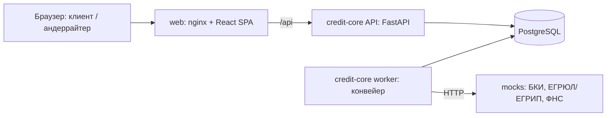

# Архитектура и стек

## 1. Выбранный стек и почему

| | Выбрано: Python + FastAPI | Рассматривали: Java/Kotlin + Spring Boot | Рассматривали: TypeScript + NestJS |
| --- | --- | --- | --- |
| Скорость разработки прототипа | высокая | ниже (больше шаблонного кода, долгая сборка) | средняя |
| OpenAPI | генерируется из кода → документ всегда совпадает с реализацией | springdoc, нужна дисциплина аннотаций | декораторы, частично вручную |
| Валидация данных | Pydantic v2 из коробки | Bean Validation | class-validator |
| Правила скоринга | естественно на Python, легко тестировать | многословно | нормально |
| Память на сервис | ~70–90 МБ (замер на стенде) | 400–700 МБ | ~150 МБ |

**Почему FastAPI:** документация API генерируется из кода и проверяется в CI, поэтому Swagger не может разойтись с реализацией; правила скоринга и политика естественно выражаются на Python и покрываются тестами. Банковскую надёжность показываем практиками (§4), а не языком. Для промышленной версии стек банка (Java/Kotlin) — вопрос переноса сервиса, контракты API и модель данных от языка не зависят.

**Фронтенд:** React + TypeScript + Vite + Mantine 9 (формы, таблицы, лента этапов, уведомления; тема — из токенов дизайна в стиле Альфа-Банка) + TanStack Query. TypeScript-клиент генерируется из OpenAPI бэкенда (`openapi-typescript`): расхождение контракта ломает сборку, а не демо. Снимок `contracts/openapi.json` хранится в репозитории, CI проверяет, что он совпадает с кодом.

**БД:** PostgreSQL 16, миграции Alembic. **Очередь:** таблица `job` в той же БД (`SELECT … FOR UPDATE SKIP LOCKED`) — без Redis и Kafka, меньше движущихся частей. В промышленной версии заменяется брокером сообщений через паттерн outbox (§5).

Версии зафиксированы lock-файлами (`backend/uv.lock`, `mocks/uv.lock`, `frontend/package-lock.json`) и тегами базовых образов Docker.

## 2. Компоненты (docker compose)

| Сервис | Ответственность |
| --- | --- |
| `web` | SPA; nginx отдаёт статику и проксирует `/api` |
| `api` (credit-core) | REST API, аутентификация и роли, машина состояний, андеррайтинг, подписание (симуляция), выдача, журнал |
| `worker` (тот же образ) | Шаги конвейера: проверка → сбор сведений → оценка → выдача; повторы, идемпотентность, демо-паузы; планировщик истечений |
| `mocks` | Отдельный сервис с контрактами, близкими к реальным; синтетические ответы по ИНН; режим сбоя для демонстрации повторов |
| `db` | PostgreSQL; сиды: компании, пользователи, обороты, флаги, продукты, конфигурация решения |

Модули внутри credit-core: `auth`, `applications` (машина состояний), `pipeline`, `decision` (стоп-факторы, скоринг, политика, причины), `underwriting`, `signing`, `disbursement`, `audit`. Модуль `decision` — чистые функции без доступа к БД: вход → решение. Отсюда тесты на персонажах; в планах — режим предрасчёта до заявки (§5).

## 3. Аутентификация и роли

Вход по логину и паролю тестовых учёток → JWT. Роли: `CLIENT` (флаг `can_sign` на уровне связи с компанией), `UNDERWRITER`, `GUARANTOR` (поручитель). Клиент видит только заявки своей компании. **Обоснование (Q3):** в проде — SSO интернет-банка (OIDC, Alfa ID); в прототипе — локальный JWT с тем же набором ролей.

## 4. Enterprise-практики (критерий 5, T17)

- **Безопасность:** ролевая модель на каждом эндпоинте; клиентский API отдаёт только безопасные поля (отдельные схемы ответа — внутренние причины и флаги ПОД/ФТ физически не сериализуются); валидация Pydantic; секреты в `.env`, в репозитории — `.env.example`; хэш документа при подписи (целостность, 851-П).
- **Шифрование и защита данных (решение для прототипа):** пароли — хэш argon2; JWT подписан, срок 8 ч; хэш SHA-256 каждого подписываемого документа (целостность); данные синтетические. **Локальный запуск — HTTP** (самоподписанный сертификат на ПК жюри даст предупреждение браузера и сломает проверку). **Демо на сервере** — за обратным прокси с HTTPS (например, Caddy + Let's Encrypt); в compose прототипа прокси нет. Шифрование БД «на диске» и полей — не делаем: в синтетике нет реальных ПДн. Для промышленной версии (§5): TLS с ГОСТ-шифрами, шифрование томов БД, ключи ЭП в HSM, маскирование ПДн в логах, 152-ФЗ и требования ЦБ к защите информации (683-П заменено 851-П — legal).
- **Надёжность:** машина состояний с оптимистической блокировкой (`version`); идемпотентные шаги worker; повторы с паузой к внешним сервисам; журнал событий только на добавление.
- **Отказоустойчивость:** недоступный источник → повторы → ручной разбор, а не падение; healthcheck у всех контейнеров; `depends_on: service_healthy`.
- **Масштабирование:** API без состояния; worker-ов можно запустить несколько (`SKIP LOCKED`); конфигурация решения версионирована.
- **Сопровождение:** миграции, структурные JSON-логи с `correlation_id`, OpenAPI из кода, тесты: модель решения (персонажи), переходы (недопустимые → 409), сквозной сценарий API.

## 5. Развитие (для жюри, критерий 6)
Брокер сообщений и outbox; реальные интеграции (НБКИ/ОКБ, ФНС API, СМЭВ); SSO; УНЭП/КЭП; залоговый маршрут и комитет; ML-модель в роли «советника» поверх правил с мониторингом качества; предрасчёт доступной суммы до заявки; поручитель отдельной учёткой.
