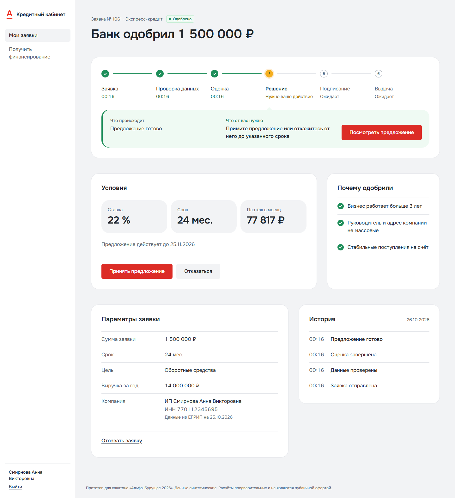
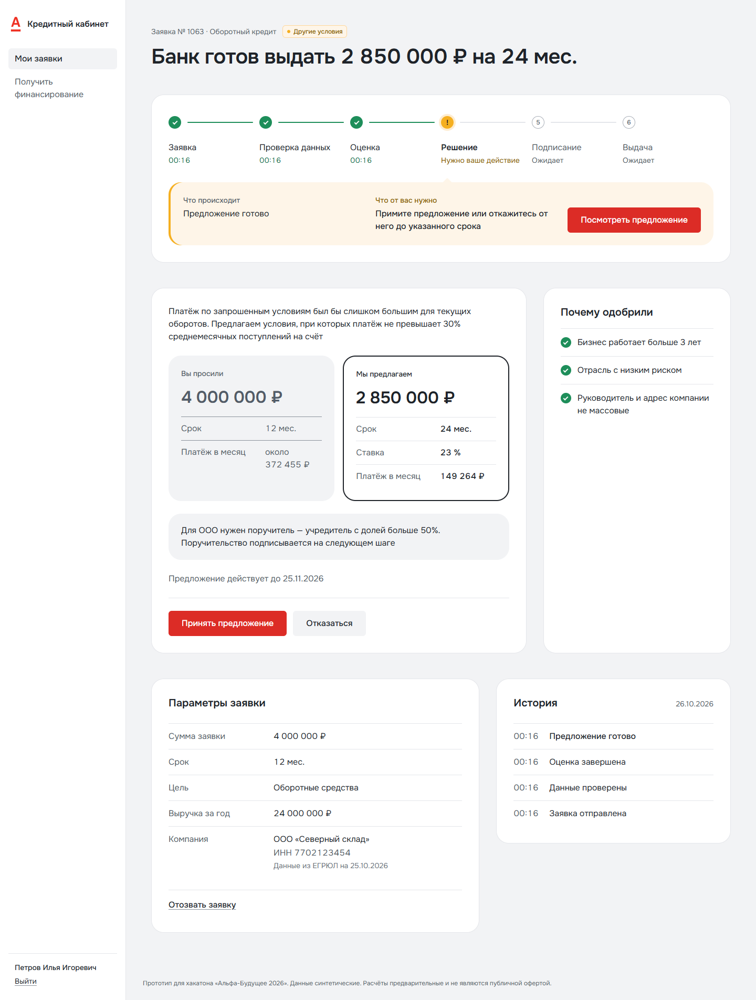
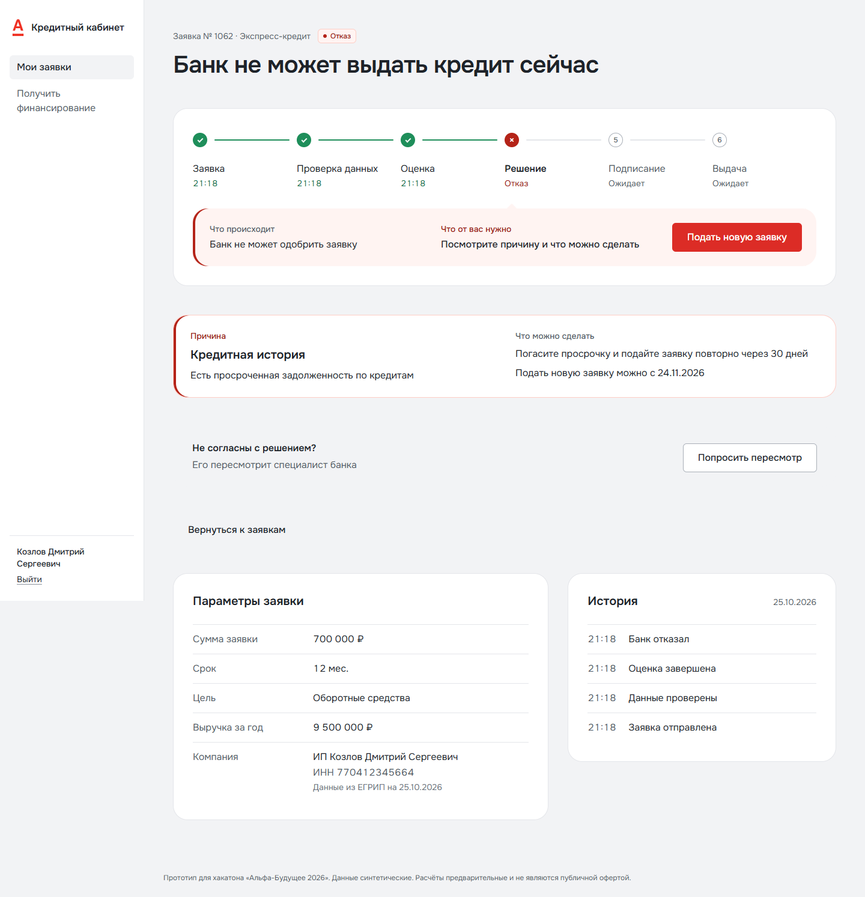
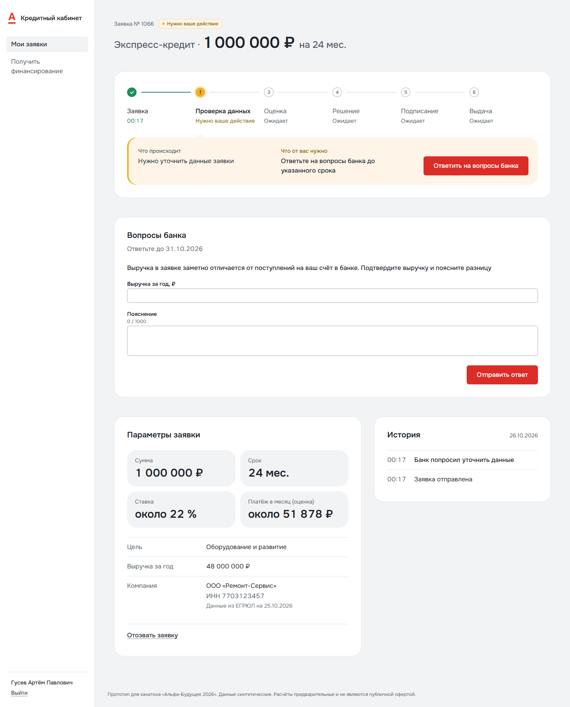
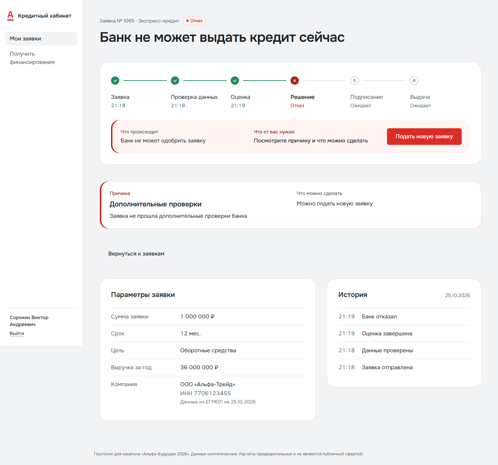
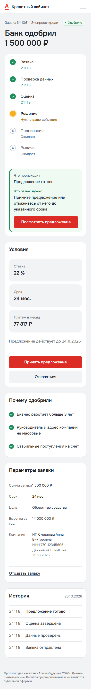
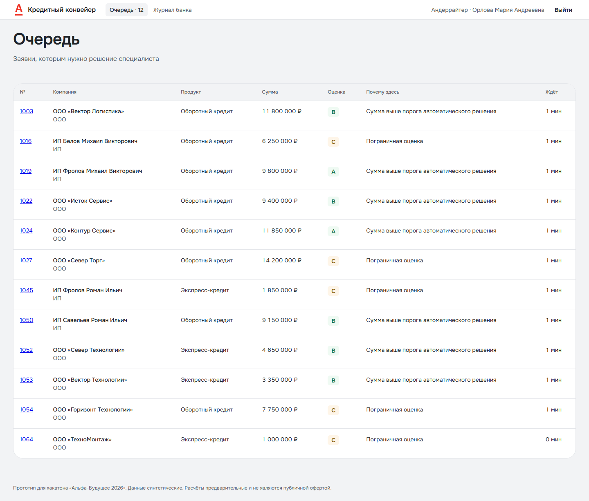
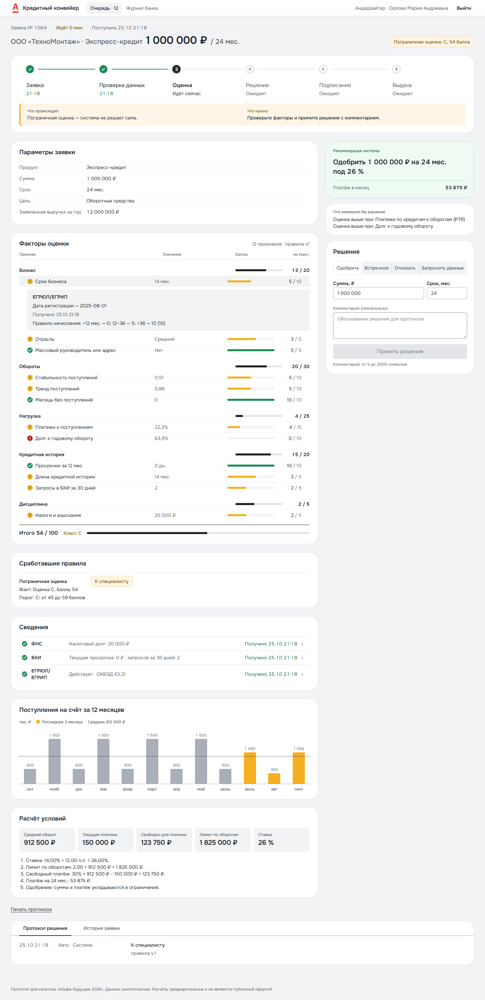
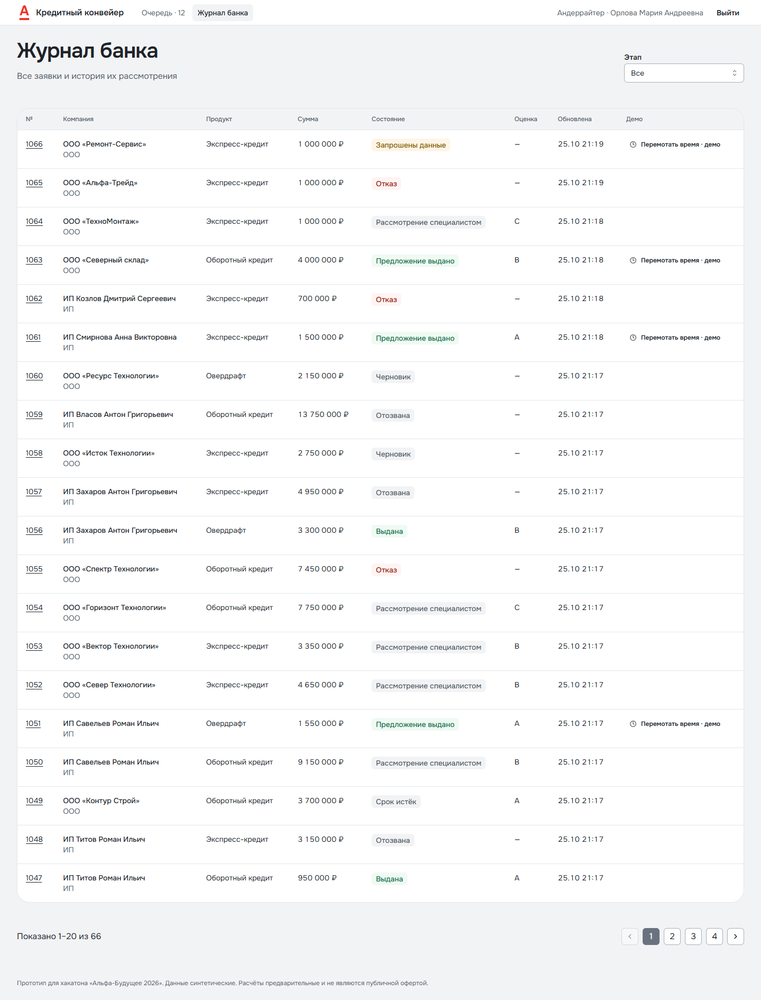
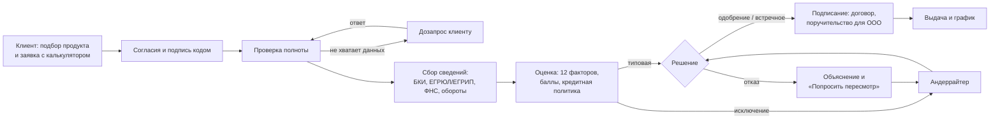

# Продукт: умный кредитный кабинет предпринимателя

Продуктовое описание решения для жюри. Как запустить и проверить — в [README](../README.md), техническое устройство — в [architecture.md](architecture.md).

## Что нас отличает

1. **Решение, которое можно понять и проверить.** Клиент видит не «отказано», а категорию причины и конкретное действие; вместо отказа при высокой нагрузке — встречное предложение с объяснением, почему сумма меньше. Андеррайтер видит те же решения изнутри: 12 факторов, баллы, кредитную политику и протокол для печати. Каждое решение воспроизводится из сохранённого снимка входных данных.
2. **Каждая цифра — с первоисточником.** Клик по фактору в карточке андеррайтера показывает, из какого источника (ЕГРЮЛ / БКИ / ФНС / обороты по счёту) пришло значение и когда. Специалист не верит системе на слово — он проверяет.
3. **Закон встроен в процесс, а не написан в сноске.** Отдельные согласия (ПДн, БКИ, авто-решение для ИП), право ИП возразить против автоматического решения (152-ФЗ ст. 16), запрет сообщать о мерах ПОД/ФТ (115-ФЗ ст. 4): у `ooo_aml` клиент видит нейтральное «не прошла дополнительные проверки», банк — настоящую причину.
4. **Компания — это несколько людей.** Бухгалтер готовит заявку, подписывает директор, поручительство даёт учредитель; право подписи проверяется, а не подразумевается по роли в интерфейсе.
5. **Банк держит человека только для исключений — и знает почему.** Типовая заявка решается за ≈ 10 секунд без ручного шага; в очередь специалиста попадают пограничные, крупные, со сбоем источника или с возражением клиента — у каждой видна причина. Решения специалиста вопреки рекомендации или стоп-фактору система не запрещает, но отмечает в истории.
6. **Проверено, а не обещано.** Запуск одной командой, 8 учёток с известными исходами, тесты API и интерфейса на живом стенде, покрытие кода 97 % (замер 24.10), отчёты по безопасности, доступности и переходам автомата состояний ([README](../README.md), «Как мы проверяли»).

## Для кого и зачем

**Клиент** — индивидуальный предприниматель или ООО, уже обслуживается в банке, банковской экспертизы нет. Ему нужно быстро получить деньги на бизнес и понимать, что происходит.

**Банк** — хочет решать типовые заявки автоматически, а людей держать для исключений, не теряя контроль риска и требований закона.

Задачи клиента, которые мы закрываем (JTBD из [research.md](research.md) §3):

| Задача клиента | Что сделали |
| --- | --- |
| Быстро получить деньги на оборотку или кассовый разрыв | 3 продукта без залога; типовая заявка решается автоматически за секунды, не дни |
| До подачи увидеть сумму, ставку и платёж | Калькулятор в форме заявки: ставка и платёж пересчитываются при смене суммы и срока |
| Не вводить заново то, что банк уже знает | Данные компании, оборотов, ИНН подставляются из профиля клиента; спрашиваем только цель, сумму, срок и выручку |
| Видеть, где заявка и что от меня нужно | Лента этапов «что происходит» и «что от вас нужно» на каждом шаге; метка «Нужно ваше действие» в списке заявок |
| Понять отказ или урезанную сумму и что делать | Объяснение решения простыми словами: категория причины и действие («снизьте сумму», «подтвердите выручку»); встречное предложение вместо отказа |

## Ключевые возможности

**Клиент**
- Подбор продукта по цели («Зачем нужны деньги») → форма с калькулятором → согласия (ПДн, БКИ, для ИП — на автоматическое решение) с подписью кодом.
- Лента статуса в карточке заявки обновляется сама, без перезагрузки: проверка → сбор сведений → оценка → решение → подписание → выдача.
- Решение с объяснением: одобрение, встречное предложение (меньше сумма или другой срок с пояснением, почему) или отказ с понятной причиной и тем, что можно сделать.
- Дозапрос в той же заявке: банк спрашивает конкретное (например, подтвердить выручку), клиент отвечает в форме — без звонков и повторной подачи.
- «Попросить пересмотр» при несогласии с решением — заявку рассматривает специалист (для ИП это право по 152-ФЗ ст. 16).
- Роли внутри компании: бухгалтер готовит заявку и отправляет на подпись директору; подписывает только тот, у кого есть право подписи. Для ООО — договор и поручительство учредителя.
- Выдача и график платежей.
- Кабинет работает на телефоне: все экраны клиента адаптированы под ширину 375 px (мобильная шапка с меню, без горизонтальной прокрутки) — проверено автообходом.

**Банк (андеррайтер)**
- Очередь исключений с причиной, почему заявка здесь («Пограничная оценка», «Сумма выше порога автоматического решения», «Клиент не согласен с решением», «Клиент ответил на вопросы»), оценкой и временем ожидания.
- Карточка заявки: итог оценки и 12 факторов по группам; клик по фактору раскрывает первоисточник (ЕГРЮЛ / БКИ / ФНС / обороты по счёту) со временем получения; график оборотов за 12 месяцев; рекомендация системы с условиями.
- Решение специалиста: одобрить, встречное, отказать, запросить данные. Если решение расходится с рекомендацией или идёт вопреки стоп-фактору — система предупреждает и отмечает это в истории.
- Журнал всех заявок с фильтрами, история событий, печать протокола решения.
- Демо-перемотка времени: показать истечение срока оферты или дозапроса, не дожидаясь 30 дней.

## Как это выглядит

Снимки с работающего стенда (синтетические данные, 25.10.2026). Нажмите на снимок, чтобы открыть его в полном размере.

**Клиент: решение с объяснением.** Лента этапов, «что происходит / что от вас нужно», условия и «почему одобрили» простыми словами (`ip_good`).

**Клиент: встречное предложение** вместо отказа — меньшая сумма и почему (`ooo_load`).

**Клиент: отказ с причиной и «Попросить пересмотр»** (`ip_bad`) и дозапрос в той же заявке (`ooo_gap`).

**Клиент: отказ по дополнительным проверкам** — нейтральная формулировка, без ПОД/ФТ и внутренних кодов (`ooo_aml`).

**Клиент на телефоне** (375 px).

**Банк: очередь исключений** — у каждой заявки видно, почему она у специалиста.

**Банк: карточка андеррайтера** — 12 факторов с баллами, раскрытый первоисточник фактора (ЕГРЮЛ, время получения, правило начисления), рекомендация, «что изменило бы решение», сведения из источников, обороты за 12 месяцев, расчёт условий и протокол.

**Банк: журнал всех заявок** с фильтром по этапам и демо-перемоткой времени.

## От исследования к решениям

| Что узнали (источник) | Что решили | Где увидеть |
| --- | --- | --- |
| Клиентам больно от непрозрачности и отказа без объяснения; как банки объясняют решение, в открытых источниках не описано ([research.md](research.md) §3) | Главное отличие — **объяснимое решение** и понятный ход рассмотрения, а не просто «статус» | Карточка заявки клиента, сценарии 1, 4 README |
| Банк **не обязан** объяснять отказ, но **запрещено** сообщать клиенту о мерах ПОД/ФТ (115-ФЗ ст. 4) ([research.md](research.md) §4 п. 7) | Два уровня причин: клиенту — категория и действие; банку — все факторы. Отказ по дополнительным проверкам — нейтральная формулировка без слов AML, ПОД/ФТ, 115-ФЗ | `ooo_aml` у клиента и у андеррайтера |
| Для ИП при автоматическом решении нужны согласие, разъяснение и право возразить (152-ФЗ ст. 16) | Отдельное согласие на авто-решение; кнопка «Попросить пересмотр» → очередь специалиста | `ip_bad`, сценарий 4 README |
| Роль в интерфейсе ≠ право подписи; для ООО нужен поручитель-учредитель с долей > 50 % (практика Альфа-Банка, [research/market.md](research/market.md)) | Подписант и поручитель — отдельные участники заявки, у каждого своя подпись кодом; бухгалтер без права подписи может только подготовить заявку | `ooo_load_accountant` → `ooo_load` |
| Метрики банка — time-to-yes и доля заявок без ручного шага ([research.md](research.md) §3) | Конвейер решает типовое сам; человек подключается правилом: пограничная оценка, сумма выше порога, недоступный источник, возражение клиента | Очередь андеррайтера |
| Встречное предложение — естественное следствие кредитной политики ([research.md](research.md) §6 п. 5) | При высокой нагрузке — меньшая сумма вместо отказа: банк сохраняет выдачу, клиент получает деньги | `ooo_load`: 2 850 000 ₽ вместо 4 000 000 ₽ |
| Ставки рынка ≈ ключевая ставка + спред ([research.md](research.md) §5) | Ставка продукта = ключевая ставка (параметр с датой) + спред − скидки; смена ставки ЦБ — одна правка конфигурации | Калькулятор, [decision-model.md](decision-model.md) |
| ML и LLM не обязательны и баллов не дают (вебинар); объяснимость нужна по закону | Оценка на правилах: 12 признаков, балльная модель и отдельная кредитная политика — каждое решение воспроизводимо и объяснимо | Протокол решения у андеррайтера |

## Как устроен процесс

Все переходы заявки заданы автоматом состояний ([state-machine.md](state-machine.md)): недопустимый переход отклоняется, каждое событие пишется в журнал. Сроки оферты (30 дней) и дозапроса (5 дней) истекают автоматически.

## Чем решение сильнее

- **Понятность для клиента без банковской экспертизы.** На каждом шаге — что происходит и что сделать; причины решения простыми словами; ни одного внутреннего кода, балла или класса на экранах клиента (проверено автообходом, [audit/ui.md](audit/ui.md)).
- **Прозрачность для банка.** Специалист видит, почему заявка у него, из чего сложилась оценка и откуда каждое значение; решения вопреки рекомендации отмечаются.
- **Реалистичный банковский процесс.** Согласия как отдельные документы, роли и право подписи, поручительство, слой политики причин отказа, скрытие ПОД/ФТ, журнал действий.
- **Надёжность.** Автомат состояний, защита от двойных действий (гонки), повтор шагов конвейера при сбое источника, проверка доступа к чужим заявкам ([audit/security.md](audit/security.md)).
- **Проверяемость.** Одна команда запуска, 8 демо-учёток с заранее известными исходами, сценарий проверки за 15 минут, автотесты API и интерфейса ([README](../README.md), «Как мы проверяли»).

## Польза и издержки

| | Клиент | Банк |
| --- | --- | --- |
| Польза | Профиль уже заполнен; видно, где заявка и что делать; понятно, почему отказ или меньшая сумма и что изменить | Типовые заявки без ручного шага — ниже стоимость и time-to-yes; человек только для исключений; меньше повторных бесполезных заявок; встречное вместо отказа сохраняет выдачу |
| Издержки | Нужно дать согласия; пересмотр занимает больше времени, чем авто-решение | Объяснение причин требует дисциплины (слой политики, снимок решения); очередь специалиста требует SLA; риск «научить обходу» снят категориями причин без порогов и весов |

## Ограничения прототипа и развитие

Ограничения — осознанные допущения ([assumptions.md](assumptions.md)): вход по тестовым учёткам вместо SSO интернет-банка; внешние источники — локальные моки с синтетическими данными; подпись — простая электронная подпись кодом; выдача без проводок в АБС; только кредиты без залога.

Что дальше (17–27.11 и после):
- предрасчёт доступной суммы до заявки по данным счёта — норма рынка (предодобрение у Альфы, Сбера, Т-Банка);
- зонтичное поручительство Корпорации МСП для крупных сумм;
- залоговые продукты и крупная сделка ООО (решение участников);
- уведомления клиенту о смене этапа и сроках;
- SLA и распределение очереди между специалистами.
