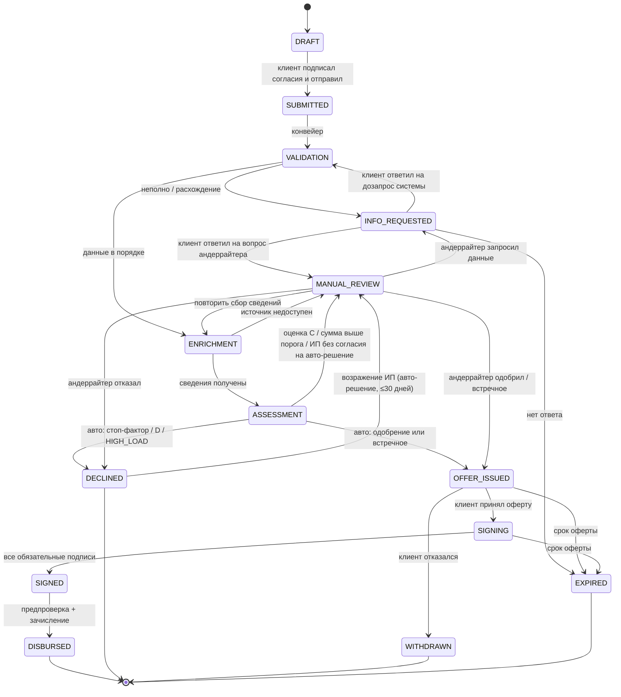

# Машина состояний заявки

Источник правды для бэкенда, фронтенда, тестов и диаграммы для жюри (T10). Любой переход вне таблицы отклоняется с ошибкой `409 INVALID_TRANSITION` (F19). Каждый переход пишет событие в журнал (`application_event`: кто, когда, из какого состояния, в какое, причина).

## Диаграмма

Отзыв клиентом (`→ WITHDRAWN`) возможен из любого состояния до `SIGNED`; на диаграмме показан один переход, чтобы не загромождать.

## Таблица переходов

| Из | В | Триггер | Кто | Условие |
| --- | --- | --- | --- | --- |
| DRAFT | SUBMITTED | `POST /applications/{id}/submit` | подписант | обязательные поля; согласия ПДн и БКИ (и авто-решение для ИП — да/нет) подписаны |
| SUBMITTED | VALIDATION | worker | система | — |
| VALIDATION | INFO_REQUESTED | worker | система | правило полноты или сверки сработало; создаётся `info_request` |
| VALIDATION | ENRICHMENT | worker | система | проверки пройдены |
| INFO_REQUESTED | VALIDATION | `POST /applications/{id}/info-response` | клиент | `info_request.source = SYSTEM`; ответ на все пункты; ответ закрывает правило |
| INFO_REQUESTED | MANUAL_REVIEW | `POST /applications/{id}/info-response` | клиент | `info_request.source = UNDERWRITER`; заявка возвращается тому же андеррайтеру без повторного конвейера (`route_reason = INFO_RESPONSE`) |
| ENRICHMENT | ASSESSMENT | worker | система | ответы всех источников получены |
| ENRICHMENT | MANUAL_REVIEW | worker | система | источник недоступен после 3 попыток; создаётся `decision(kind=AUTO, outcome=MANUAL, route_reason=SOURCE_UNAVAILABLE)` без оценки |
| ASSESSMENT | OFFER_ISSUED | worker | система | порядок правил `decision-model.md` §6a дал одобрение или встречное, условий ручного рассмотрения нет |
| ASSESSMENT | DECLINED | worker | система | §6a дал отказ (стоп-фактор, D, `HIGH_LOAD`), условий ручного рассмотрения нет |
| ASSESSMENT | MANUAL_REVIEW | worker | система | хотя бы одно условие ручного рассмотрения (§6a п. 4); итог автомата сохраняется как рекомендация |
| MANUAL_REVIEW | OFFER_ISSUED / DECLINED / INFO_REQUESTED | `POST /underwriting/{id}/decision` | андеррайтер | обязательный комментарий; при `DECLINE` — клиентская категория причины |
| MANUAL_REVIEW | ENRICHMENT | `POST /underwriting/{id}/decision` с `RETRY_ENRICHMENT` | андеррайтер | только при `route_reason = SOURCE_UNAVAILABLE` |
| DECLINED | MANUAL_REVIEW | `POST /applications/{id}/objection` | клиент-ИП | решение было автоматическим; ≤30 дней; возражение одно |
| OFFER_ISSUED | SIGNING | `POST /applications/{id}/offer/accept` | подписант | оферта актуальна (последняя версия, не истекла) |
| OFFER_ISSUED | WITHDRAWN | `POST /applications/{id}/offer/reject` | клиент | — |
| SIGNING | SIGNED | `POST /applications/{id}/sign` | подписант (+ поручитель) | подписи всех обязательных участников (`party.required_signature`) |
| SIGNED | DISBURSED | worker | система | оферта принята; создаются `disbursement`, график, событие `BKI_REPORT` (согласие БКИ не проверяется: сообщение о выданном кредите его не требует, а провал шага оставил бы заявку в SIGNED — решение 24.10, B-09b) |
| * до SIGNED | WITHDRAWN | `POST /applications/{id}/withdraw` | клиент | кроме `DECLINED`: из отказа выход только возражением (`ALLOWED` в `backend/app/applications/state_machine.py`, ответ тимлида A-07 25.10) |
| INFO_REQUESTED, OFFER_ISSUED, SIGNING | EXPIRED | планировщик | система | истёк `due_at` / `offer.expires_at` |

## Состояния → этапы ленты для клиента

| Этап ленты | Внутренние состояния | Что видит клиент («что происходит / что от вас нужно») |
| --- | --- | --- |
| 1. Заявка | DRAFT, SUBMITTED | Заполните заявку и подпишите согласия / Заявка отправлена |
| 2. Проверка данных | VALIDATION, ENRICHMENT, INFO_REQUESTED | Проверяем данные и запрашиваем сведения / **Нужно уточнить данные** (кнопка) |
| 3. Оценка | ASSESSMENT, MANUAL_REVIEW | Оцениваем заявку / Заявку рассматривает специалист — обычно до 1 рабочего дня |
| 4. Решение | OFFER_ISSUED, DECLINED | Предложение готово — примите или откажитесь / Отказ: причина и что делать |
| 5. Подписание | SIGNING, SIGNED | Подпишите договор (и поручитель) |
| 6. Выдача | DISBURSED | Деньги зачислены, график платежей |
| — | WITHDRAWN, EXPIRED | Заявка отозвана / истекла — можно подать новую |

Демо-скорость: системные шаги выполняются с паузой `PIPELINE_STEP_DELAY_SEC` (по умолчанию 2 с), чтобы движение по ленте было видно. В тестах — 0.

## Участники подписи (`party`)
Создаются при `DRAFT → SUBMITTED`: `BORROWER_SIGNATORY` — текущий пользователь с `can_sign`; `GUARANTOR` — если продукт требует поручителя (ООО: учредитель с долей >50%; ИП: сумма > 3 млн — в MVP ИП-поручитель не моделируется, сумма ограничена). В B-lite `party(GUARANTOR).user_id` = пользователь-директор, если он и есть учредитель (персонажи так устроены). `POST /sign` с `party_id` разрешён, только если `party.user_id` = текущий пользователь. Согласия поручителя (ПДн, БКИ) подписываются вместе с поручительством на шаге `SIGNING`.

## Задел под B
- Б1 — поручитель отдельной учёткой: `SIGNING` ждёт подписи `party(role=GUARANTOR)`. В B-lite её ставит та же сессия, в B — учётка `guarantor`. Машина состояний не меняется.
- Б2 — предрасчёт: вызов скоринга и политики в режиме `preview` вне машины состояний (без заявки, без основной части КИ), результат переносится в `DRAFT`.
